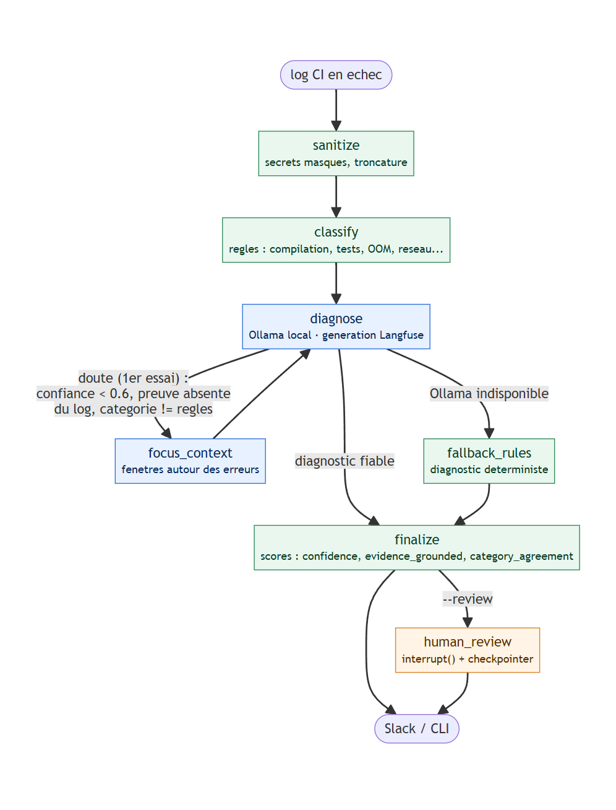

# pipeline-doctor

[](https://github.com/A-Djihadi/pipeline-doctor/actions/workflows/ci.yml)
[](https://github.com/A-Djihadi/pipeline-doctor/actions/workflows/codeql.yml)
[](LICENSE)

Agent qui lit le log d'un build CI en echec et propose un diagnostic : cause probable, preuves tirees du log, correctif suggere.

> Statut : sessions 1-3 faites (CLI, webhook Slack, agent auto-heberge) + mode graphe LangGraph tracé dans Langfuse (ADR-0005). Decision : Ollama only — aucune cle API cloud, pas d'escalade (ADR-0004).


*(source modifiable : `docs/architecture.excalidraw`, a ouvrir sur excalidraw.com)*

## Principes
- **Lecture seule** envers la CI et le depot surveille : l'agent lit, il n'applique rien.
- **Correctifs sur opt-in, jamais merges par l'agent** : en mode `pr`, l'agent ouvre une PR *draft* depuis un fork bot ; il ne peut pas la merger, l'approuver ni lancer sa CI lui-meme (ADR-0008).
- **Secrets masques** avant tout envoi a un modele (tokens, mots de passe, cles AWS, URLs avec identifiants).
- **Local only** : Ollama traite tous les diagnostics, aucun modele cloud (ni DeepSeek, ni Claude), aucune cle API cloud.
- **Zero dependance** pour le coeur : bibliotheque standard Python uniquement. LangGraph et Langfuse sont un extra optionnel (`requirements-agent.txt`).

## Utilisation
```bash
# Prerequis : Ollama lance, avec un modele (defaut : qwen2.5-coder:3b)
export PYTHONPATH=src
python -m pipeline_doctor examples/maven-compile-error.log             # diagnostic
python -m pipeline_doctor examples/maven-compile-error.log --dry-run   # voir ce qui serait envoye
cat build.log | python -m pipeline_doctor -                            # depuis stdin
```
Variables : `OLLAMA_URL` (defaut `http://localhost:11434`), `OLLAMA_MODEL`.

### Journal des diagnostics (lecture seule)
```bash
python -m pipeline_doctor journal                                    # 20 derniers diagnostics (tableau texte)
python -m pipeline_doctor journal show 12345                         # detail complet d'un run
python -m pipeline_doctor journal --html                             # page HTML autonome (CSS inline, zero JS)
python -m pipeline_doctor journal --repo owner/repo --status llm_error --limit 50
```
- Base lue par defaut : `$PD_DB`, sinon `diagnostics.db` (la meme que l'agent). `--db <fichier>` pour en lire une autre.
- Lecture seule : le journal n'est jamais cree ni modifie ; un fichier absent est traite comme un journal vide.

## Webhook GitHub Actions + Slack
Quand la CI (`ci.yml`) echoue, le workflow [`diagnose.yml`](.github/workflows/diagnose.yml) se declenche
automatiquement (evenement `workflow_run`), recupere le log des jobs en echec, le nettoie (sanitizer)
et poste un extrait sur Slack via un Incoming Webhook.

- Secret requis : `SLACK_WEBHOOK_URL` (URL de l'Incoming Webhook, dans Settings > Secrets and variables > Actions).
- Sans ce secret (fork, PR externe), la notification est ignoree sans faire echouer le run.
- Test manuel : `gh workflow run diagnose.yml -f run_id=<id-du-run>` (voir le payload sans poster : `--dry-run`).
- Voir [ADR-0002](docs/adr/0002-webhook-notification-slack.md).

## Agent auto-heberge (diagnostic LLM local)
Un service autonome sur ton serveur Ollama poll l'API GitHub, diagnostique les runs en echec avec
un modele local et notifie Slack (cause, confiance, correctif). Idempotent via un journal SQLite :
un run est traite une seule fois.

- Lancer : `PD_REPO=... GITHUB_TOKEN=... python -m pipeline_doctor.agent --once` (ou `--interval 300`).
- Voir [deploy/](deploy/) (systemd + cron) et [ADR-0003](docs/adr/0003-agent-auto-heberge.md).

## Source Jenkins (ADR-0007)

En plus de GitHub Actions, l'agent peut poller des jobs Jenkins (lecture seule, API JSON) :

```bash
PD_SOURCES=github,jenkins \
PD_JENKINS_URL=https://jenkins.example.com \
PD_JENKINS_JOBS=team/app/main \
PD_JENKINS_USER=<utilisateur-lecture-seule> \
PD_JENKINS_TOKEN=<api-token> \
PYTHONPATH=src python -m pipeline_doctor.agent --once
```

- Le compte Jenkins doit avoir `Overall/Read` + `Job/Read` (voir [deploy/](deploy/)).
- Les builds `FAILURE` termines sont diagnostiques comme les runs GitHub, une seule fois (journal `jenkins_diagnostics`).
- Alternative zero-code, pour un pipeline donne :
  `curl -s -u <user>:<token> https://jenkins.example.com/job/app/12/consoleText | python -m pipeline_doctor -`

## Correctifs proposes (ADR-0008)

Pour un run GitHub eligible (diagnostic LLM, categorie `compilation`/`tests`/`dependency`),
l'agent peut proposer un patch minimal (search/replace exact + gardes deterministes) :

- **`PD_FIX_MODE=propose`** : poste le diff (deja garde) sur Slack, sans aucune ecriture.
- **`PD_FIX_MODE=pr`** : ouvre une PR *draft* depuis un fork bot (`PD_FIX_FORK`, `PD_FIX_TOKEN`).
  Le bot n'a aucun droit sur l'upstream : seule une personne humaine peut approuver la CI du
  fork, marquer la PR prete, l'approuver et la merger.

```bash
PD_FIX_MODE=pr PD_FIX_FORK=pd-bot/pipeline-doctor PD_FIX_TOKEN=<classic-pat-public_repo> \
PYTHONPATH=src python -m pipeline_doctor.agent --once
```

Tout est **off par defaut** : sans `PD_FIX_MODE`, le comportement v1 est identique. Voir
[ADR-0008](docs/adr/0008-fix-pr-human-validation.md) et [deploy/](deploy/) pour les actions owner.

## Mode graphe : LangGraph + Langfuse (ADR-0005)



Le diagnostic devient un **graphe d'etats** : chaque etape est un noeud, chaque decision une arete.

| Noeud | Role |
|---|---|
| `sanitize` | masque les secrets, tronque (rien de brut ne va plus loin) |
| `classify` | regles deterministes : categorie d'echec (compilation, dependances, tests, OOM, registre, reseau, config, disque) |
| `diagnose` | appel Ollama ; *generation* Langfuse (prompt versionne, tokens, latence) ; le modele donne aussi sa categorie |
| `focus_context` | doute sur le diagnostic : 2e essai avec les seules fenetres d'erreur (max 2 essais). Doute = confiance < 0.6, preuve citee absente du log, ou categorie du modele differente de celle des regles (raisons dans `retry_reasons`) |
| `fallback_rules` | Ollama indisponible : diagnostic par regles, marque `source=rules` |
| `finalize` | scores : `confidence`, `evidence_grounded` (preuves presentes dans le log = anti-hallucination) |
| `human_review` | `--review` : `interrupt()` + checkpointer, le graphe attend une validation humaine |

```bash
pip install -r requirements-agent.txt
PYTHONPATH=src python -m pipeline_doctor.graph examples/maven-compile-error.log          # diagnostic
PYTHONPATH=src python -m pipeline_doctor.graph examples/oom-killed.log --review          # avec validation
PYTHONPATH=src python -m pipeline_doctor.graph --mermaid                                 # schema
PYTHONPATH=src python -m pipeline_doctor.evals                                           # evaluation
PD_ENGINE=graph python -m pipeline_doctor.agent --once                                   # agent en mode graphe
```

**Traces** : demarrer Langfuse en local (`deploy/langfuse/up.sh` ou `up.ps1`), exporter
`LANGFUSE_BASE_URL`, `LANGFUSE_PUBLIC_KEY`, `LANGFUSE_SECRET_KEY` ; chaque diagnostic affiche
l'URL de sa trace. `evals --langfuse` cree le dataset et lance une *experience* comparable
entre modeles / versions de prompt. Sans cles, le tracing est desactive (no-op).
`python -m pipeline_doctor.tracing` publie `llm.SYSTEM_PROMPT` en `production` dans Langfuse,
seulement si le texte a change (pas de version en double).

**Evaluation** (`examples/` + `expected.json`, 9 logs dont 3 pieges ou le symptome masque la
cause) : `category_match` (categorie du modele, pas des regles), `cause_keyword` (mots-cles
attendus et mots interdits, sans accents), `evidence_grounded`, `no_secret_leak`, `safe_fix`
(pas de contournement : `--force`, `--legacy-peer-deps`, tests desactives...). Le repli par
regles sert de *baseline* ; il rate volontairement les logs pieges. Un modele ou un prompt n'est
adopte que s'il fait au moins aussi bien sur l'ancrage des preuves et zero fuite. La CI rejoue
l'evaluation et echoue sur toute fuite.

## Tests
```bash
PYTHONPATH=src python -m unittest discover -s tests -v   # stdlib : tests du graphe ignores
pip install -r requirements-agent.txt && PYTHONPATH=src python -m unittest discover -s tests -v
```

## Feuille de route
- [x] 1. CLI : log -> sanitizer -> Ollama -> diagnostic
- [x] 2. Webhook GitHub Actions + notification Slack (log nettoye, sans LLM)
- [x] 3. Agent auto-heberge : poll GitHub -> Ollama -> Slack (diagnostic continu)
- [x] ~~4. Escalade vers DeepSeek / Claude si confiance < seuil~~ *(decision : Ollama only, pas d'escalade cloud — ADR-0004)*
- [x] 5a. Graphe LangGraph (re-essai, repli, validation humaine) + traces et evaluations Langfuse (ADR-0005)
- [x] 5. Journal des diagnostics (UI) — consultation en CLI (`journal`, `journal show`) + export HTML
- [ ] 5b. Demo video
- [ ] 5c. Article
- [x] v2. Support Jenkins, ouverture de PR avec validation humaine

## Securite et documentation
- Failles : voir [SECURITY.md](SECURITY.md) (signalement prive, pas d'issue publique).
- Contribuer : [CONTRIBUTING.md](CONTRIBUTING.md). Decisions d'architecture : [docs/adr/](docs/adr/). Historique : [CHANGELOG.md](CHANGELOG.md).
