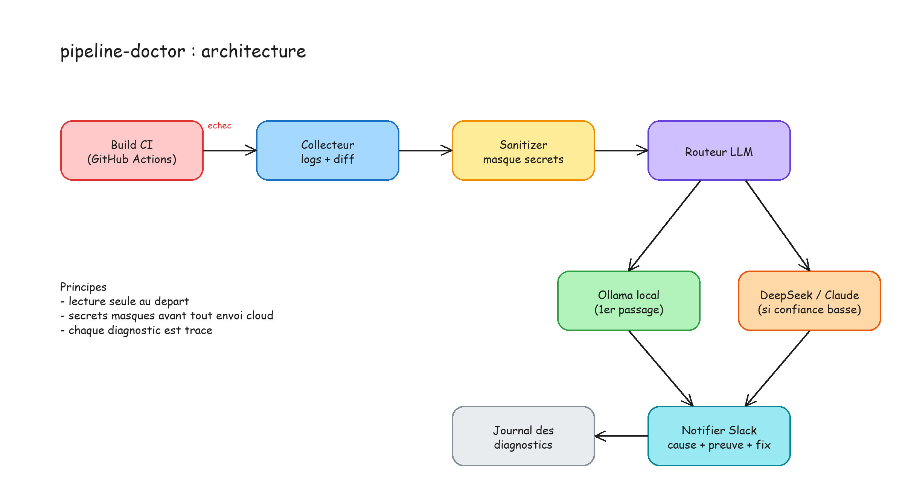

# pipeline-doctor

[](https://github.com/A-Djihadi/pipeline-doctor/actions/workflows/ci.yml)
[](https://github.com/A-Djihadi/pipeline-doctor/actions/workflows/codeql.yml)
[](LICENSE)

Agent qui lit le log d'un build CI en echec et propose un diagnostic : cause probable, preuves tirees du log, correctif suggere.

> Statut : session 2/4. Detection d'echec CI + notification Slack (log nettoye) en place. Escalade cloud et journal des diagnostics arrivent ensuite.


*(source modifiable : `docs/architecture.excalidraw`, a ouvrir sur excalidraw.com)*

## Principes
- **Lecture seule** : l'agent propose, il n'applique rien.
- **Secrets masques** avant tout envoi a un modele (tokens, mots de passe, cles AWS, URLs avec identifiants).
- **Local d'abord** : Ollama traite le cas courant, un modele cloud n'est sollicite que si la confiance est basse.
- **Zero dependance** : bibliotheque standard Python uniquement.

## Utilisation
```bash
# Prerequis : Ollama lance, avec un modele (defaut : qwen2.5-coder:3b)
export PYTHONPATH=src
python -m pipeline_doctor examples/maven-compile-error.log             # diagnostic
python -m pipeline_doctor examples/maven-compile-error.log --dry-run   # voir ce qui serait envoye
cat build.log | python -m pipeline_doctor -                            # depuis stdin
```
Variables : `OLLAMA_URL` (defaut `http://localhost:11434`), `OLLAMA_MODEL`.

## Webhook GitHub Actions + Slack
Quand la CI (`ci.yml`) echoue, le workflow [`diagnose.yml`](.github/workflows/diagnose.yml) se declenche
automatiquement (evenement `workflow_run`), recupere le log des jobs en echec, le nettoie (sanitizer)
et poste un extrait sur Slack via un Incoming Webhook.

- Secret requis : `SLACK_WEBHOOK_URL` (URL de l'Incoming Webhook, dans Settings > Secrets and variables > Actions).
- Sans ce secret (fork, PR externe), la notification est ignoree sans faire echouer le run.
- Test manuel : `gh workflow run diagnose.yml -f run_id=<id-du-run>` (voir le payload sans poster : `--dry-run`).
- Voir [ADR-0002](docs/adr/0002-webhook-notification-slack.md).

## Tests
```bash
PYTHONPATH=src python -m unittest discover -s tests -v
```

## Feuille de route
- [x] 1. CLI : log -> sanitizer -> Ollama -> diagnostic
- [x] 2. Webhook GitHub Actions + notification Slack (log nettoye, sans LLM)
- [ ] 3. Escalade vers DeepSeek / Claude si confiance < seuil
- [ ] 4. Journal des diagnostics, demo video, article
- [ ] v2. Support Jenkins, ouverture de PR avec validation humaine

## Securite et documentation
- Failles : voir [SECURITY.md](SECURITY.md) (signalement prive, pas d'issue publique).
- Contribuer : [CONTRIBUTING.md](CONTRIBUTING.md). Decisions d'architecture : [docs/adr/](docs/adr/). Historique : [CHANGELOG.md](CHANGELOG.md).
